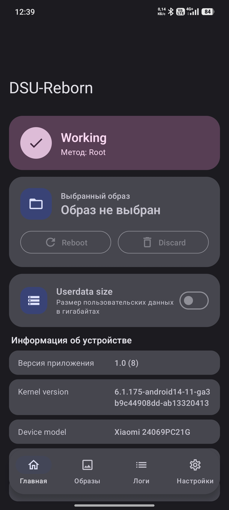
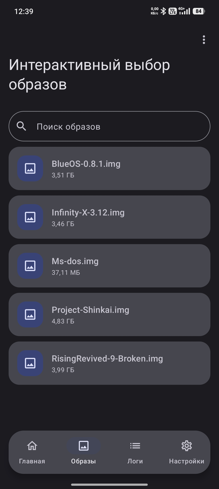
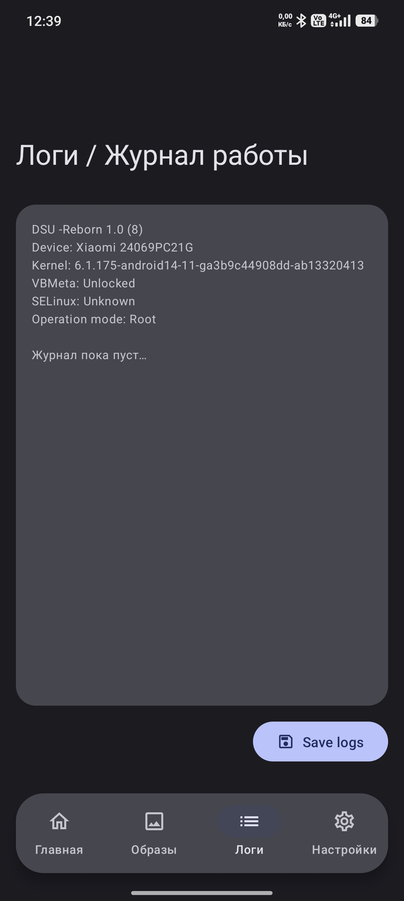
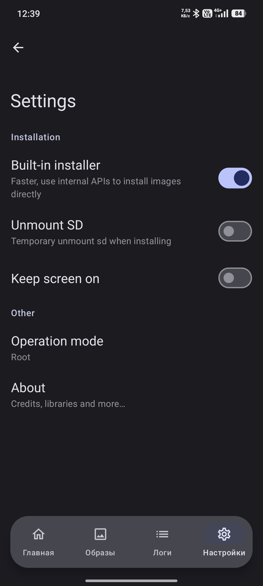

# DSU-Reborn

DSU-Reborn is a fork of [DSU Sideloader](https://github.com/VegaBobo/DSU-Sideloader) with a Material Design 3 interface and a set of usability improvements for installing GSIs through Android's Dynamic System Updates feature.

[](https://github.com/MrJourStone/DSU-Reborn/releases/latest)

## Screenshots

<table>
  <tr>
    <td align="center"><br><sub><b>Home</b></sub></td>
    <td align="center"><br><sub><b>Image selection</b></sub></td>
  </tr>
  <tr>
    <td align="center"><br><sub><b>Logs</b></sub></td>
    <td align="center"><br><sub><b>Settings</b></sub></td>
  </tr>
</table>

## Features

- Material Design 3 interface with Monet dynamic color support.
- Floating navigation dock that stays out of the way while dialogs and bottom sheets are open.
- Dedicated tabs for image selection and installation logs.
- Remembers the selected `.img` file between app launches.
- Userdata size control with validation against the available allocation limit.
- Root, Shizuku, ADB, and system operation modes.
- Installation progress, diagnostics, and optional built-in DSU installer.

## Requirements

- Android 10 or higher
- Unlocked bootloader
- Device with Dynamic Partitions
- A GSI you want to use

Community GSIs: https://github.com/phhusson/treble_experimentations/wiki/Generic-System-Image-%28GSI%29-list

Google GSIs: https://developer.android.com/topic/generic-system-image/releases

**Remember to use GSIs compatible with your architecture and VNDK implementation.**

## Downloads

Download the latest signed APK from the [Releases section](https://github.com/MrJourStone/DSU-Reborn/releases/latest).

Current release: **DSU-Reborn v1.0** (`DSU-Reborn-v1.0.apk`).

## How to use

1. Install the app.
2. On first launch, grant read/write access to a folder. This folder is used for temporary files, such as GSIs extracted from compressed archives.
3. Select a GSI to install. Accepted formats are `gz`, `xz`, `img`, and `zip` (only DSU packages).
4. Adjust the installation options if needed:
   - You can change the userdata size for the dynamic system.
   - Changing the GSI image size is not recommended; let the app calculate it automatically.
5. Tap **Install**.
6. Wait for the installation to finish. Depending on the operation mode, you may need to confirm the DSU installation from the system dialog or run an ADB command.
7. Once the dynamic system is ready, boot into it from the notification, or directly from the app when the operation mode supports it.

For more information, see [Operation modes](#operation-modes).

## Operation modes

DSU-Reborn supports several operation modes. The app selects the best available mode automatically; it cannot be changed manually. The most capable supported mode is preferred.

1. **ADB**: Default mode when no other mode is available.
   - Prepares the selected image for installation through the DSU system app.
   - Requires an ADB command to start the installation.
2. **Shizuku**: Available when Shizuku permission is granted.
   - Same as ADB, but does not require running an ADB command.
   - Supports installation progress tracking.¹ ² ³
   - Supports installation diagnostics for common errors.¹ ³
3. **Root**: Available when root permission is granted.
   - Includes all Shizuku features without requiring special permissions.
   - Provides DynamicSystem API features: check whether DSU is installed, reboot into DSU, discard the installation, and more.
   - Supports the built-in DSU installer.⁴ ⁵
4. **System mode**: Available when installed as a system app through the Magisk module.
   - Includes all Shizuku features.
   - Fixes some common GSI/DSU-related SELinux denials.
   - Includes a custom `gsid` binary that can fix installation errors on some devices.⁵ ⁶
5. **System/Root mode**: Available when running as a system app with root permission.
   - Includes all features from the Root and System modes.

¹ Requires the `READ_LOGS` permission.
<br>
² Partial support on Android 10 and 11.
<br>
³ Android 13 requires "One-time log access".
<br>
⁴ Not supported on Android 10.
<br>
⁵ Experimental feature. The built-in installer code is [here](https://github.com/MrJourStone/DSU-Reborn/blob/master/app/src/main/java/vegabobo/dsusideloader/installer/root/DSUInstaller.kt).
<br>
⁶ The module with the custom `gsid` binary is optional. Changes to the AOSP `gsid` binary are [here](https://github.com/MrJourStone/DSU-Reborn/tree/master/magisk-module/src/main/resources/aosp_patches).

### Recommendations

- For non-rooted devices, Shizuku is the most convenient option. Install and configure [Shizuku](https://play.google.com/store/apps/details?id=moe.shizuku.privileged.api) first.
- For rooted devices, Root mode is sufficient for most users.
- If you have issues with DSU, try System/Root mode.
- Rooted devices using Magisk should run Magisk v24 or newer. Older versions may break DSU.
- Stock ROMs are recommended. Some custom ROM builds may also work.

## Common questions

1. **DSU installation finishes without errors, but the device does not boot into the installed DSU. What should I do?**
   - AVB may be preventing the device from booting the installed image. Try flashing a disabled vbmeta image. See [the Android documentation](https://developer.android.com/topic/generic-system-image#flash-gsi) for details.
2. **Why can't I set a higher userdata value?**
   - The more free storage you have, the more you can allocate to userdata. Some Android versions limit the maximum allocation to 40% of available space. This is an Android limitation, not an app limitation. The custom `gsid` binary reduces the limit to 20%.
3. **Why does the "Unmount SD" option exist?**
   - When available, DSU prefers allocating on the SD card, but allocation on SD cards is not supported in some cases. This option forces allocation on internal storage.
4. **Why does the built-in installer require root?**
   - It uses Android's internal DynamicSystem API, which requires the signature-level `MANAGE_DYNAMIC_SYSTEM` permission. Root is the practical way to access it. The shell user has `INSTALL_DYNAMIC_SYSTEM` and can ask the DSU system app to perform the installation.
5. **How do I get updates?**
   - Check the [Releases section](https://github.com/MrJourStone/DSU-Reborn/releases). Release APKs are signed with the DSU-Reborn release key.
6. **Something else is wrong. Where can I report it?**
   - Open an issue in this repository. Include logs when possible; installation logs can be viewed directly in the app when the active operation mode supports diagnostics.

## About DSU

DSU (Dynamic System Updates) is a feature introduced in Android 10 that lets developers boot GSIs without modifying the current system partition. Android creates separate partitions for the GSI and its userdata, then boots from them when requested.

DSU requires Dynamic Partitions. Most GSIs also require an unlocked bootloader, because only OEM-signed GSIs are allowed to boot on locked bootloaders.

GSIs can be installed through DSU without root access by using ADB commands. Read more about the installation process in the [Android documentation](https://developer.android.com/topic/dsu).

After installation, Android creates a persistent notification that lets you boot into the Dynamic System. Your original system partition and userdata remain untouched. To return to the original system, simply reboot.

For longer testing sessions, you can enable sticky mode to keep booting into the dynamic system until you disable it.

You can read more about DSU here: https://source.android.com/devices/tech/ota/dynamic-system-updates

## How to enable Sticky Mode

Boot into the dynamic system, then use one of the following:

- ADB: `adb shell gsi_tool enable`
- Local ADB shell: `gsi_tool enable`
- Local rooted shell (for example, Termux on a rooted GSI): `su -c 'gsi_tool enable'`

To disable sticky mode, use the same command with `disable` instead of `enable`.

## Building from source

Requirements:

- JDK 17
- Android SDK with platform 33 and build-tools installed

Build the debug variant:

```bash
./gradlew assembleMiniDebug
```

Build a release APK:

```bash
./gradlew assembleRelease
```

Release signing is read from `.sign/dsu_sideloader.prop` at the repository root:

```properties
keystore=/absolute/path/to/release.jks
keystore_pw=your_store_password
alias=your_key_alias
alias_pw=your_key_password
```

The `.sign` directory is ignored by git. Never commit signing keys or passwords.

## Credits

- Original DSU Sideloader by [VegaBobo](https://github.com/VegaBobo) and contributors.
- DSU-Reborn fork maintained by [MrJourStone](https://github.com/MrJourStone).
- Original DSU Sideloader icon by [WSTxda](https://github.com/WSTxda).

## License

DSU-Reborn is distributed under the same license as the original project. See [LICENSE](LICENSE).
